<b><a href="https://soham-cheme.github.io/Soham-ChemE/">Open the live page</a></b> · one particle cloud that morphs through all seven projects as you scroll, each shape built from that project's own data, each headline number counting up as its project comes into focus

<h3 align="center">Soham Kavathekar · MS Chemical &amp; Biomolecular Engineering, University of Pennsylvania (May 2027) · process engineering, semiconductor processing and batteries</h3>

Physics-based and data-driven models of energy materials and processes, checked the way a fab or a cell line would check them: designed experiments, capability statistics, and every number re-run from raw data before it is believed.

---

## Projects

Each card leads with the project's strongest verified number, reproduced from the repository's own data (the audit trail is in every repo's `docs/CLAIMS.md`), and links to the code and to a live page where every figure is an interactive 3D scene.

<table>
<tr>
<td width="50%" valign="top">

###  ALD chamber-to-feature model (OpenFOAM)
**0.35 s → 14 s: the TMA pulse that saturates a blanket 300 mm wafer against the pulse a 3D-NAND-like wafer of 100 nm holes at aspect ratio 100 (56× the wall area) needs, a 40.7× under-dose hidden in every blanket-wafer recipe.** A showerhead ALD chamber in OpenFOAM in which every wafer face runs its own feature-scale hole model through a C++ boundary condition, two-way coupled to the gas. The resulting supply rule, tpulse = 1.2 (1 + Awall/Awafer) N₀/(U c₀), holds within 25 % over aspect ratios 20 to 100 and a 20× range of TMA feed across 12 chamber runs; the hole model agrees with Argonne's Machball to 0.3–7 %, fits published PillarHall profiles, and the rule puts a measured fluidized-bed ALD run on 940 m² of silica gel at 1.12× the supply limit. 25-run central composite design (JMP response surface, R² 0.993), Gaussian-process surrogates in MATLAB and scikit-learn (LOO R² 0.999), utilization 51 to 97 %, 12 % precursor saving per wafer at the same pulse time.
`OpenFOAM` `C++ boundary conditions` `JMP` `MATLAB` `scikit-learn`
[Repository](https://github.com/Soham-ChemE/ald-conformality) · [Live page](https://soham-cheme.github.io/ald-conformality/)

</td>
<td width="50%" valign="top">

###  CathodeAI: structure-aware cathode screening
**Spearman ρ = 0.76 (p = 0.007) on 11 experimentally characterised cathodes.** Built an eight-layer funnel over 2,774 Li-ion insertion electrodes from the Materials Project and a three-descriptor Degradation Screening Index that outranks volume strain alone (0.55) and puts 10 of 11 cathodes on the right side of the durable split. Sole author; preprint on ChemRxiv, manuscript under revision at *Phys. Chem. Chem. Phys.*
`Python` `pymatgen` `scikit-learn` `SHAP`
[Repository](https://github.com/Soham-ChemE/CathodeAI-Battery-Materials-Screener) · [Live page](https://soham-cheme.github.io/CathodeAI-Battery-Materials-Screener/)

</td>
</tr>
<tr>
<td width="50%" valign="top">

###  LiMn₂O₄ half cell: PyBaMM rate model on my own data
**26 mV training RMSE with three fitted parameters; the unseen 2C average voltage predicted within 17 mV.** Cycled commercial LMO half cells on a Bio-Logic VMP-300 (CV at 0.1 to 0.3 mV/s; C/10 to 2C), fitted a Doyle-Fuller-Newman model on C/5 and C/2 only, validated it blind at 2C and against all six CV peaks (within 80 mV), and named the 2C loss: 74 % ohmic, 17 % charge transfer, 6 % diffusion. 58 automated tests.
`PyBaMM` `SciPy` `pytest`
[Repository](https://github.com/Soham-ChemE/LMO-Cathode-Rate-Model-PyBaMM) · [Live page](https://soham-cheme.github.io/LMO-Cathode-Rate-Model-PyBaMM/)

</td>
<td width="50%" valign="top">

###  CVD reactor uniformity in COMSOL
**Wafer non-uniformity from 179.6 % to 3.3 %.** Built a 300 mm single-wafer showerhead reactor (2D axisymmetric: flow, heat, species, surface kinetics), diagnosed the starved deposit as mass-transfer limited (Da above 10), fixed it at the inlet (10 to 150 mm gives 6.1 %) and reached 3.3 % at 0.07 m/s with a 14-run central composite design. Gaussian-process surrogate with leave-one-out R² 0.944, 10,000-draw Monte Carlo on MFC and thermocouple tolerances, 3D model with asymmetric exhaust at 5.9 %.
`COMSOL` `DOE` `Gaussian process` `Monte Carlo`
[Repository](https://github.com/Soham-ChemE/CVD-Reactor-Uniformity-COMSOL) · [Live page](https://soham-cheme.github.io/CVD-Reactor-Uniformity-COMSOL/)

</td>
</tr>
<tr>
<td width="50%" valign="top">

###  Ionic liquids at carbon nanotube walls (MD)
**[OMIM]⁺ binds at −8.75 kcal mol⁻¹ per ion.** All-atom NAMD simulations of four imidazolium [BF₄] ionic liquids confined in a (15,15) nanotube showed that chain length sets orientation, binding and mobility at the wall. Co-author, *Structural Chemistry* (Springer Nature, 2024), doi 10.1007/s11224-024-02323-3. The repository ships the 19,260-atom minimised structure, which the live page renders.
`NAMD` `OPLS-AA` `VMD`
[Repository](https://github.com/Soham-ChemE/MD-IL-CNT-Interfacial-Interactions) · [Live page](https://soham-cheme.github.io/MD-IL-CNT-Interfacial-Interactions/)

</td>
<td width="50%" valign="top">

###  ZnSe/CdTe thin-film cell in SCAPS-1D
**27.99 % simulated efficiency** with a Cs₂BiAgI₆ electron-transport layer and nickel contact (VOC 1.21 V, JSC 25.96 mA cm⁻², FF 89.3 %), from a six-parameter design of experiments over ten electron-transport layers and nine back-contact metals on an FTO/ZnSe/CdTe heterojunction. Spiral panel architecture with 17.9 % more active area: two granted Indian design registrations, one utility application under review. Best Poster Award, 61st Annual Convention of Chemists.
`SCAPS-1D` `drift-diffusion` `device physics`
[Repository](https://github.com/Soham-ChemE/Perovskite-Solar-Cell-SCAPS1D-Optimization) · [Live page](https://soham-cheme.github.io/Perovskite-Solar-Cell-SCAPS1D-Optimization/)

</td>
</tr>
<tr>
<td width="50%" valign="top">

###  4680 thermal-runaway propagation in COMSOL
**A sharp cascade threshold in through-layer conductivity between 1.0 and 1.25 W m⁻¹ K⁻¹.** Built a 20-cell 5s4p pack of 4680 cells on COMSOL's validated propagation model (25 Ah, 110 kJ per cell, 80 °C trigger) and ran twelve transient one-hour studies over base cooling from 0 to 2,000 W m⁻² K⁻¹: below the threshold about 13 of 20 cells cascade within the hour, above it propagation stops at the initiating cell; the threshold is a property of the cell rather than the cooling, and internal conduction, not the base contact, is the controlling resistance. Reduced-order model and tested scaling analysis in the repository.
`COMSOL Battery Design Module` `reduced-order model` `pytest`
[Repository](https://github.com/Soham-ChemE/4680-Thermal-Runaway-Propagation-COMSOL) · [Live page](https://soham-cheme.github.io/4680-Thermal-Runaway-Propagation-COMSOL/)

</td>
<td width="50%" valign="top"></td>
</tr>
</table>

Also ongoing, in the Rappé group at Penn: Berry-phase spontaneous polarization of MHy₂PbBr₄ computed at 5.6 µC cm⁻², within the 4.6 to 5.8 µC cm⁻² experimental range (DFT, Quantum ESPRESSO, collaboration with Oak Ridge CNMS).

## Toolkit

OpenFOAM (C++ boundary conditions) · COMSOL Multiphysics (Battery Design Module) · PyBaMM · Python (NumPy, pandas, scikit-learn, SciPy, SHAP, matplotlib) · DFT with Quantum ESPRESSO · SCAPS-1D · NAMD and VMD · DOE (central composite, factorial) in JMP, SPC, Cpk and Monte Carlo tolerance analysis · Aspen HYSYS · MATLAB · LaTeX · Linux and HPC job scheduling

## Experience

Chemical process intern, Lubrikote Specialities (2025): DOE and SPC on a die-casting release-agent line, formulation, SOPs and KPI dashboards · Process engineering intern, Lupin (GMP API plant, 2023): zero-liquid-discharge water reclamation, solvent-recovery distillation, HAZOP and permit-to-work audits · Quality assurance intern, Britannia Industries (2023): raw-material and in-process analytics under ISO 22000, ISO 9000 and HACCP.

## Publications, patents, awards

- Biswas R., Banerjee P., **Kavathekar S. S.**, "Molecular dynamics studies on interfacial interactions between imidazolium-based ionic liquids and carbon nanotubes", *Structural Chemistry* **35**, 1743–1753 (2024). [10.1007/s11224-024-02323-3](https://doi.org/10.1007/s11224-024-02323-3)
- **Kavathekar S.**, CathodeAI: structure-aware degradation screening of lithium-ion cathodes. Preprint, ChemRxiv, [10.26434/chemrxiv.15010709/v1](https://doi.org/10.26434/chemrxiv.15010709/v1); manuscript under revision at *Phys. Chem. Chem. Phys.* (2026).
- Design registrations (Government of India, co-inventor): Detachable Spiral Solar Panel, 434427-001 (granted Oct 2024); Dual-Layer Detachable Spiral Solar Panel, 459195-001 (granted May 2025); utility application on the fabrication method under review.
- Best Poster Award, 61st Annual Convention of Chemists (ACC 2024), Indian Chemical Society.

## Education

**University of Pennsylvania**, MS Chemical and Biomolecular Engineering, 2025 to 2027, GPA 3.45/4.0 · Deputy Director to the President of GAPSA, Penn's graduate student government, which represents more than 12,000 students
**Vellore Institute of Technology**, B.Tech Chemical Engineering, 2021 to 2025, GPA 3.88/4.0

## Contact

[stg3719@seas.upenn.edu](mailto:stg3719@seas.upenn.edu) · [linkedin.com/in/soham-kavathekar-cheme](https://www.linkedin.com/in/soham-kavathekar-cheme) · [github.com/Soham-ChemE](https://github.com/Soham-ChemE) · [live project pages](https://soham-cheme.github.io/Soham-ChemE/)
